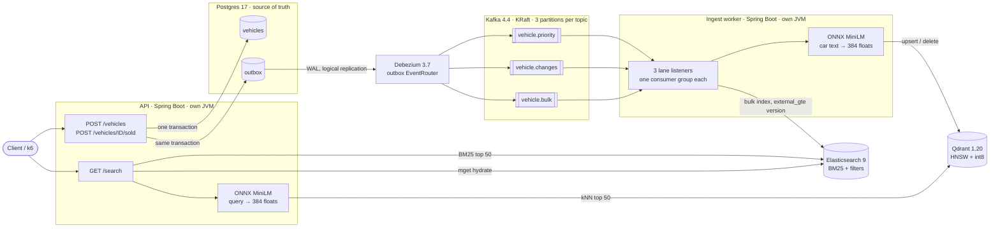
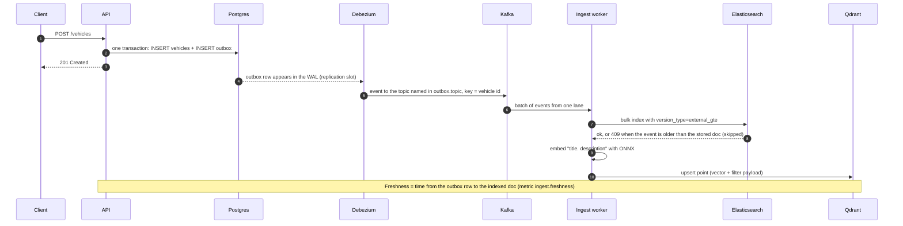
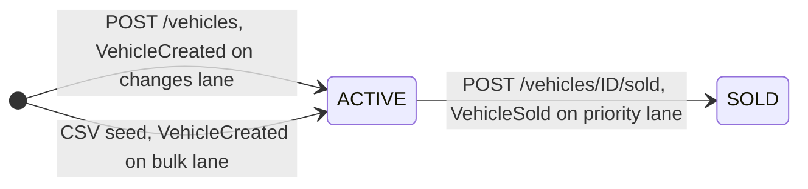
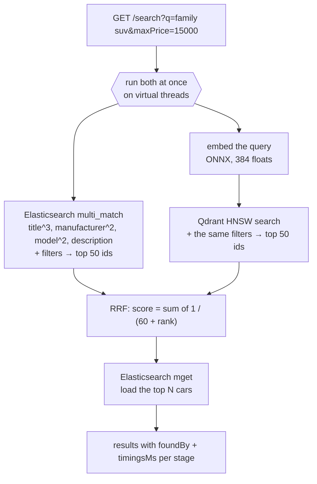
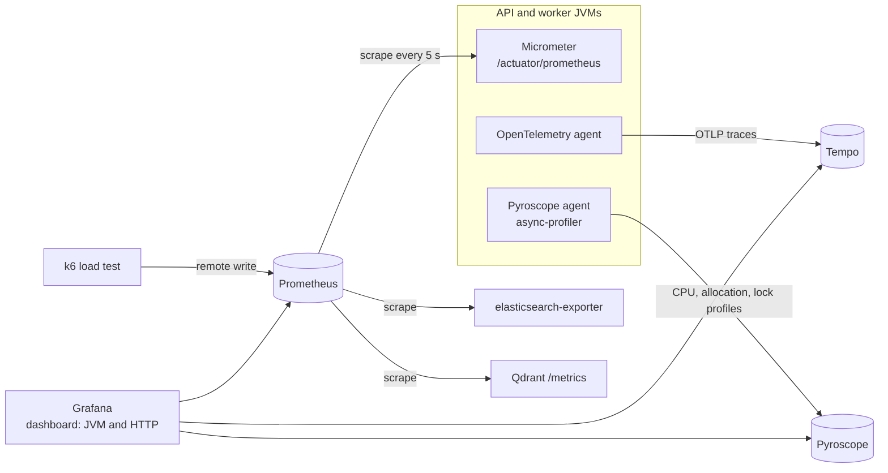
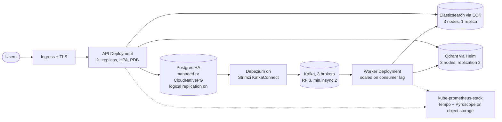

# Car Marketplace: hybrid search on the JVM

A FINN.no-style used-car marketplace, built to learn how a search backend behaves on the JVM under real data and real load.
It is loaded with **426,880 real Craigslist car ads**.

- **Write path:** REST API → Postgres → transactional outbox → Debezium CDC → Kafka (3 priority lanes) → ingest worker → Elasticsearch + Qdrant.
- **Read path:** hybrid search. BM25 in Elasticsearch and vector search in Qdrant run in parallel, then get merged with Reciprocal Rank Fusion.
- **Embeddings:** `all-MiniLM-L6-v2` runs inside the JVM through ONNX Runtime. There's no Python service.
- **Platform:** everything runs on Kubernetes, with Prometheus, Grafana, Tempo (traces), Pyroscope (continuous profiling), Kibana, Kafka UI, and k6 for load tests.

| | |
|---|---|
| Language / runtime | Kotlin 2.3, Java 25 (G1 GC), virtual threads |
| Framework | Spring Boot 4.1 (Spring Data JDBC, Spring Kafka, Micrometer) |
| Storage | Postgres 17 (source of truth), Elasticsearch 9.5 (BM25), Qdrant 1.20 (vectors) |
| Pipeline | Debezium 3.7 outbox `EventRouter`, Kafka 4.4 (KRaft) |
| ML | ONNX Runtime 1.31, `all-MiniLM-L6-v2` int8 (384 dimensions, 23 MB) |
| Observability | Prometheus 3.9, Grafana 13, Tempo 3.1, Pyroscope 2.4, OpenTelemetry Java agent 2.33 |
| Build | Gradle 9.8 wrapper, 3 modules |

## Contents

- [Architecture](#architecture)
- [Repository layout](#repository-layout)
- [Quick start on OrbStack](#quick-start-on-orbstack)
- [Install on minikube](#install-on-minikube)
- [Local development](#local-development)
- [Database migrations](#database-migrations)
- [API](#api)
- [Observability](#observability)
- [Load testing](#load-testing)
- [Production deployment](#production-deployment)
- [Results and lessons](#results-and-lessons)
- [Troubleshooting](#troubleshooting)
- [Configuration reference](#configuration-reference)

---

## Architecture



The API and the worker are **two separate programs**, each with its own JVM, Docker image and Deployment. They share one Gradle library, `embedding`. The API never writes to Elasticsearch or Qdrant directly. It writes to Postgres only, and the pipeline carries the change everywhere else.

### Write path: from a new ad to search



Why it's built like this:

- **Transactional outbox + CDC.** The car row and its event are committed together. If Kafka is down, nothing is lost: Debezium catches up from the WAL later. The app never "writes to the DB, then publishes" (a dual write that can half-fail). `OutboxCleaner` deletes outbox rows after 5 minutes, and Debezium ignores those deletes (`skipped.operations=d,t`).
- **At-least-once delivery, idempotent consumer.** Kafka may deliver an event twice. Elasticsearch stores the car's `version` as an external version with `external_gte`, so a duplicate is applied again harmlessly and an older event can't overwrite a newer one.
- **Retry forever on outages.** If Elasticsearch restarts, the worker backs off exponentially (1 s up to 30 s) and does not skip the batch. Only unparseable JSON is skipped.

### Priority lanes

A 400k-car backfill must not delay "this car is sold". Every event goes to one of three topics. Each topic has its own consumer group, so its lag is independent of the others.

| Lane | Topic | Events | Consumer group | Threads | Batch |
|---|---|---|---|---|---|
| priority | `vehicle.priority` | `VehicleSold` | `ingest-priority` | 1 | 50, fetch wait 50 ms |
| changes | `vehicle.changes` | `VehicleCreated` from `POST /vehicles` | `ingest-changes` | 3 | 32 |
| bulk | `vehicle.bulk` | `VehicleCreated` from the CSV seed | `ingest-bulk` | 3 | 64 |



| State | Elasticsearch | Qdrant |
|---|---|---|
| ACTIVE | document indexed, `status=ACTIVE` | point upserted (vector + `title`, `manufacturer`, `price`, `year`, `location`) |
| SOLD | document updated, `status=SOLD` (search filters on `ACTIVE`) | point deleted |

Measured during a 30k-car bulk seed: a sold car left search in **1.1 s** on the priority lane, against **42.4 s** when sold events waited in the bulk lane. To reproduce the "before" case, set `events.priority-lane-enabled=false`.

### Read path: hybrid search



- **Filters** apply in both engines: `status=ACTIVE`, `maxPrice`, `minYear`, `manufacturer`, and geo radius (`lat`, `lon`, `radiusKm`).
- **RRF** uses ranks, not scores. BM25 scores and cosine similarities are on different scales, so ranks are the fair way to merge them. A car ranked high in both lists beats one ranked high in only one.
- **`mode=BM25` or `mode=VECTOR`** runs only one half, to compare quality and latency. Each hit says which side found it (`foundBy`).
- **An empty `q`** runs a filter-only search.

### Observability



Both agents attach through `JAVA_TOOL_OPTIONS`, so the code has no tracing or profiling calls. Prometheus finds pods by their `prometheus.io/*` annotations.

---

## Repository layout

```
.
├── build.gradle.kts            API build, agent download, migrate-* tasks
├── settings.gradle.kts         3 modules: root (API), ingest-worker, embedding
├── Dockerfile                  API image: JDK build stage → JRE 25 + agents + model
├── src/main/kotlin/no/carmarketplace/
│   ├── vehicles/               entity, repository, service, controller, DTOs, event
│   ├── outbox/                 outbox entity, publisher, cleaner, lanes
│   ├── search/                 hybrid search: Elasticsearch + Qdrant + RRF
│   ├── seed/                   CSV seeder behind POST /admin/seed
│   └── db/Index.kt             @Index annotation, read by the migration generator
├── src/main/resources/
│   ├── application.yaml
│   └── db/changelog/           generated SQL migrations (Liquibase formatted SQL)
├── src/test/kotlin/no/carmarketplace/Migrations.kt   migrate-generate / up / down
├── embedding/                  shared library: WordPiece tokenizer + ONNX embedder (+ tests)
├── ingest-worker/              Kafka consumer → Elasticsearch + Qdrant (own Dockerfile)
├── k8s/dev/
│   ├── namespace.yaml          carmarketplace
│   ├── deployment.yaml         api + ingest-worker
│   ├── services.yaml           api LoadBalancer :8080
│   ├── resources/              postgres, kafka (+ connect, kafka-ui), elasticsearch (+ exporter,
│   │                           elasticvue), qdrant, kibana, monitoring, tracing, profiling
│   └── connectors/             Debezium outbox connector config
├── loadtest/                   k6 script, stage runner, report builder
└── datasets/                   vehicles.csv (not in git)
```

---

## Quick start on OrbStack

This is the tested setup: an Apple Silicon Mac with OrbStack's single-node Kubernetes. OrbStack publishes every `LoadBalancer` service on `localhost`, and its Kubernetes uses the same Docker images you build locally.

### 0. Prerequisites

| Tool | Why | Install |
|---|---|---|
| [OrbStack](https://orbstack.dev) | Docker + Kubernetes | Settings → Kubernetes → enable. Settings → System → give it **10–12 GB** memory |
| JDK 25 | Gradle toolchain (Kotlin 2.3 targets up to Java 25) | `brew install openjdk@25` then `sudo ln -sfn /opt/homebrew/opt/openjdk@25/libexec/openjdk.jdk /Library/Java/JavaVirtualMachines/openjdk-25.jdk` |
| kubectl | talk to the cluster | ships with OrbStack |
| curl, python3 | connector setup, checks, load-test report | macOS / Homebrew |
| k6 (optional) | load tests | `brew install k6` |

Resource requests add up to about 4.2 GiB of memory and 3.2 CPUs. The JVMs, Elasticsearch and Kibana grow toward their limits under load, which is why the VM needs more than the requests.

### 1. Get the dataset

Download [Used Cars Dataset (Craigslist)](https://www.kaggle.com/datasets/austinreese/craigslist-carstrucks-data) and put `vehicles.csv` (1.4 GB, 426,880 rows) in `datasets/`:

```bash
mkdir -p datasets
# with the Kaggle CLI, or download the zip in the browser and unzip it here
kaggle datasets download -d austinreese/craigslist-carstrucks-data -p datasets --unzip
ls -lh datasets/vehicles.csv
```

The seeder uses `id`, `price`, `year`, `manufacturer`, `model`, `description`, `lat`, `long`.

### 2. Create the secrets files

These files are gitignored. Pick your own password and use the same one in all three.

```bash
cat > k8s/dev/postgres.env <<'EOF'
POSTGRES_DB=carmarketplace
POSTGRES_USER=carmarketplace
POSTGRES_PASSWORD=change-me
EOF

cat > k8s/dev/api.env <<'EOF'
DB_URL=jdbc:postgresql://postgres:5433/carmarketplace?user=carmarketplace&password=change-me
EOF

# for Gradle on your Mac (migrations, bootRun): same database, reached through localhost
cat > .env <<'EOF'
DB_URL=jdbc:postgresql://localhost:5433/carmarketplace?user=carmarketplace&password=change-me
EOF

chmod 600 k8s/dev/*.env .env
```

| File | Used by | Host |
|---|---|---|
| `k8s/dev/postgres.env` | Postgres and Debezium (Secret `postgres-credentials`). The connector reads `${env:POSTGRES_PASSWORD}`, so no password sits in its config | in the cluster |
| `k8s/dev/api.env` | API pod (Secret `api-env`) | `postgres:5433` |
| `.env` | `./gradlew migrate-*` and `:bootRun` | `localhost:5433` |

### 3. Start the infrastructure

```bash
kubectl config use-context orbstack
kubectl apply -f k8s/dev/namespace.yaml
kubectl create secret generic postgres-credentials -n carmarketplace --from-env-file=k8s/dev/postgres.env
kubectl create secret generic api-env -n carmarketplace --from-env-file=k8s/dev/api.env
kubectl apply -f k8s/dev/resources/
kubectl wait --for=condition=Ready pod --all -n carmarketplace --timeout=10m
```

The first start pulls about 15 images. Kibana is the heaviest (up to 1.5 GB) and is optional: to skip it, delete it with `kubectl delete -f k8s/dev/resources/kibana.yaml`.

### 4. Create the tables

```bash
./gradlew migrate-up
```

This applies every file in `src/main/resources/db/changelog/migrations/`, in order. Run it before the connector: Debezium needs the `outbox` table to exist.

### 5. Register the CDC connector

```bash
curl -s -X PUT localhost:8083/connectors/vehicles-outbox/config \
  -H 'Content-Type: application/json' --data @k8s/dev/connectors/vehicles-outbox.json
curl -s localhost:8083/connectors/vehicles-outbox/status   # expect "state":"RUNNING"
```

`PUT .../config` creates or updates the connector, so running it twice is safe.

### 6. Build the images and deploy the apps

```bash
docker build -t carmarketplace-api:dev .
docker build -f ingest-worker/Dockerfile -t carmarketplace-ingest-worker:dev .

# The API mounts datasets/ from your Mac with a hostPath. The manifest has the author's path: point it at yours.
sed -i '' "s#/Users/lithasan/Desktop/JVM/kotlin-hybrid-search#$PWD#" k8s/dev/deployment.yaml

kubectl apply -f k8s/dev/deployment.yaml -f k8s/dev/services.yaml
kubectl rollout status deploy/ingest-worker -n carmarketplace
kubectl rollout status deploy/api -n carmarketplace
```

The image builds download the model (pinned Hugging Face commit) and both Java agents, so pods start without network access. On startup the worker creates the Elasticsearch index and the Qdrant collection. `/search` fails until the worker is up.

After a code change:

```bash
docker build -t carmarketplace-api:dev . && kubectl rollout restart deploy/api -n carmarketplace
```

### 7. Load the data

```bash
curl -s -X POST 'localhost:8080/admin/seed?limit=10000'   # drop ?limit for all 426,880 cars
curl -s localhost:8080/admin/seed                          # progress: read, saved, skipped, perSecond
```

The seed is resumable: rows whose `source_id` already exists are skipped. The full file took **52 min** to seed (about 137 cars/s), and the worker finished about **19 min** later.

Check that all three stores agree:

```bash
curl -s 'localhost:8080/vehicles?size=1' | python3 -c 'import json,sys; print("postgres", json.load(sys.stdin)["total"])'
curl -s localhost:9200/vehicles/_count | python3 -c 'import json,sys; print("elasticsearch", json.load(sys.stdin)["count"])'
curl -s localhost:6333/collections/vehicles | python3 -c 'import json,sys; print("qdrant", json.load(sys.stdin)["result"]["points_count"])'
```

### 8. Search

```bash
curl -s 'localhost:8080/search?q=family+suv+low+miles&maxPrice=15000&minYear=2012' | python3 -m json.tool
```

### 9. Open the UIs

| UI | URL | What to look at |
|---|---|---|
| Grafana | http://localhost:3000 | dashboard **JVM and HTTP**; Explore → Tempo (traces), Pyroscope (flame graphs) |
| Kafka UI | http://localhost:8090 | topics, consumer-group lag, the Debezium connector |
| Kibana | http://localhost:5601 | Discover on the `vehicles` data view, Dev Tools console |
| Qdrant dashboard | http://localhost:6333/dashboard | collection, points, payloads |
| elasticvue | http://localhost:8091 | lightweight Elasticsearch browser |
| Prometheus | http://localhost:9090 | raw metrics, targets |

| Service | From the Mac | In the cluster |
|---|---|---|
| API | `localhost:8080` | `api:8080` |
| Postgres | `localhost:5433` | `postgres:5433` |
| Kafka | `localhost:29092` | `kafka:9092` |
| Debezium Connect REST | `localhost:8083` | `connect:8083` |
| Elasticsearch | `localhost:9200` | `elasticsearch:9200` |
| Qdrant | `localhost:6333` (HTTP), `6334` (gRPC) | `qdrant:6333/6334` |
| Tempo | `localhost:3200`, OTLP `4317`/`4318` | `tempo:4318` |
| Pyroscope | `localhost:4040` | `pyroscope:4040` |

### Stop, restart, remove

- Quitting OrbStack stops everything. Postgres, Kafka, Elasticsearch and Qdrant keep their data on persistent volumes.
- Prometheus, Tempo and Pyroscope use `emptyDir`, so their data is lost when their pods restart.
- `kubectl delete namespace carmarketplace` removes **everything, including the data volumes**. Only use it when you mean it.

---

## Install on minikube

> Written from the OrbStack setup and not yet run on minikube. The manifests are the same; only how images, the dataset folder and `LoadBalancer` services reach the cluster differs.

```bash
minikube start --driver=docker --cpus=6 --memory=12g --disk-size=40g
```

Your Docker VM (Docker Desktop, Colima or OrbStack) must have at least that much memory.

Then follow the OrbStack steps with these four differences.

**1. LoadBalancer services on localhost.** Keep this running in its own terminal. It may ask for your password.

```bash
minikube tunnel
```

With the Docker driver on macOS this binds each `LoadBalancer` service to `127.0.0.1`, so `localhost:5433`, `:8083` and `:8080` work as in the steps above. Start it before step 4, because `migrate-up` connects to `localhost:5433`.

**2. The dataset folder.** Keep this running too. Mounting at the same path means the `hostPath` in `deployment.yaml` doesn't need to change (after the `sed` in step 6).

```bash
minikube mount "$PWD/datasets:$PWD/datasets"
```

**3. Images.** minikube has its own image store, so load the images into it after building (step 6):

```bash
docker build -t carmarketplace-api:dev .
docker build -f ingest-worker/Dockerfile -t carmarketplace-ingest-worker:dev .
minikube image load carmarketplace-api:dev
minikube image load carmarketplace-ingest-worker:dev
```

The manifests use `imagePullPolicy: Never`, so a missing image shows up as `ErrImageNeverPull`. Repeat `minikube image load` after every rebuild, before `kubectl rollout restart`.

**4. Host address for local runs.** The Prometheus job `local-dev` scrapes apps started with `./gradlew bootRun` at `host.docker.internal`. On minikube that host is `host.minikube.internal`: change it in `k8s/dev/resources/monitoring.yaml` if you use local runs.

On an x86 machine everything works, but see the [model note](#2-the-embedding-model-and-cpu-architecture).

---

## Local development

Keep the infrastructure in Kubernetes and run one app from Gradle, with fast restarts and a debugger. It reaches the cluster through the `localhost` ports, and still reports metrics, traces and profiles, as `api-local` or `ingest-worker-local` in Grafana.

```bash
./gradlew :bootRun                  # API on :8081 (8080 is the API in the cluster)
./gradlew :ingest-worker:bootRun    # worker on :8082, reads Kafka on localhost:29092
./gradlew test                      # tokenizer + embedding tests (downloads the model first)
```

- **Use the leading `:`.** `bootRun` without it runs in every module, so both apps would start.
- **Pause the in-cluster worker** while debugging yours. Otherwise both share the same consumer groups and split the partitions between them:

  ```bash
  kubectl scale deploy/ingest-worker -n carmarketplace --replicas=0
  ```
- **Both local runs use the same JVM flags as the pods:** G1, GC logging, both agents. Each GC prints one line to the console.

---

## Database migrations

Migrations work like TypeORM's: the Kotlin entity classes are the schema, and SQL is generated, reviewed and applied by hand. Nothing runs automatically at startup.

```bash
# 1. change an entity, e.g. add a field to Vehicle.kt or put @Index on one
# 2. diff the entities against the live database and write a new migration
./gradlew migrate-generate        # → src/main/resources/db/changelog/migrations/<timestamp>.sql
# 3. read the file, then apply it
./gradlew migrate-up
# undo the most recent migration
./gradlew migrate-down
```

A generated file has the forward SQL plus its rollback:

```sql
--liquibase formatted sql

--changeset migrate-generate:20261026-115620
ALTER TABLE public.vehicles ADD source_id BIGINT;
CREATE UNIQUE INDEX ux_vehicles_source_id ON public.vehicles USING btree (source_id);
--rollback DROP INDEX public.ux_vehicles_source_id;
--rollback ALTER TABLE public.vehicles DROP COLUMN source_id;
```

- **Indexes** are declared on the entity: `@Index(unique = true)` on a field, or `@Index("price", "year", method = IndexMethod.BTREE, order = SortOrder.DESC)` on the class. They are diffed against `pg_indexes` by name (`idx_` or `ux_` prefix).
- **A new entity class** must be added to `ENTITIES` in `src/test/kotlin/no/carmarketplace/Migrations.kt`.
- **`DB_URL`** is read from the environment first, then from `.env`.

The generator lives in the test source set, so Liquibase never ships in the app jar. It uses Spring Data's `LiquibaseChangeSetWriter` for tables, plus its own diff for indexes.

---

## API

| Method | Path | What it does |
|---|---|---|
| `POST` | `/vehicles` | create an ad. Event goes to the **changes** lane. Returns 201 |
| `POST` | `/vehicles/{id}/sold` | mark as sold. Event goes to the **priority** lane. Calling it again changes nothing |
| `GET` | `/vehicles?offset=0&size=20` | page through Postgres (size 1–100), with `total` |
| `GET` | `/search` | hybrid search, see below |
| `POST` | `/admin/seed?limit=N` | start the CSV seed in the background (202, or 409 if running). Dev only |
| `GET` | `/admin/seed` | seed progress |
| `GET` | `/actuator/health`, `/actuator/prometheus` | probes and metrics |

```bash
# create
curl -s -X POST localhost:8080/vehicles -H 'Content-Type: application/json' -d '{
  "price": 12500, "year": 2016, "manufacturer": "toyota", "model": "rav4 xle",
  "description": "One owner, full service history, new tires.", "lat": 40.73, "lon": -73.99
}'

# sell it: gone from search in about a second
curl -s -X POST localhost:8080/vehicles/<id>/sold
```

`GET /search` parameters:

| Param | Example | Notes |
|---|---|---|
| `q` | `family suv low miles` | empty = filter-only search |
| `maxPrice`, `minYear` | `15000`, `2012` | |
| `manufacturer` | `toyota` | exact match |
| `lat`, `lon`, `radiusKm` | `40.7`, `-74`, `50` | geo radius |
| `size` | `20` | 1–50 |
| `mode` | `HYBRID` (default), `BM25`, `VECTOR` | compare the two halves |

```bash
curl -s 'localhost:8080/search?q=cheap+reliable+commuter&mode=VECTOR'
curl -s 'localhost:8080/search?q=toyota+camry&mode=BM25'
curl -s 'localhost:8080/search?manufacturer=ford&lat=40.7&lon=-74&radiusKm=50'
```

The response includes `candidates` (how many hits each side returned before fusion) and `timingsMs` per stage (`bm25`, `embed`, `vector`, `fusion`, `hydrate`, `total`).

---

## Observability

The Grafana dashboard **JVM and HTTP** (pick the app at the top) has these rows:

| Row | Panels |
|---|---|
| Traffic | requests/s, latency p50/p95/p99, 5xx/s |
| JVM memory and GC | heap by area, allocation rate, GC pauses/s, longest pause, non-heap, GC CPU overhead |
| Threads, CPU, DB | JVM threads, CPU, Hikari pool |
| Pipeline | freshness p95 by lane and event, % sold indexed within 2 s, consumer lag per topic, seeded/s, indexed/s, embedding time |
| Elasticsearch | heap, GC, CPU, indexing rate, search rate and latency, thread-pool rejections, refresh/merge, doc count |
| Qdrant | points, calls/s, latency p95, failures, memory, background work |

Custom metrics (Micrometer names; Prometheus adds `_seconds` / `_total`):

| Metric | Tags | Meaning |
|---|---|---|
| `search.stage` | `stage` | time per search stage (embed, vector, bm25, fusion, hydrate, total) |
| `ingest.freshness` | `lane`, `type` | outbox row → indexed, with SLO buckets 0.5 s … 30 min |
| `ingest.events` | `lane`, `result` | indexed / stale / failed |
| `ingest.embedding` | `lane` | model time per batch |
| `seed.vehicles` | `result` | seeder saved / skipped / failed |

JVM flags (in `JAVA_TOOL_OPTIONS`, so changing them needs no rebuild):

- `-XX:+UseG1GC`: chosen explicitly. With less than 2 CPUs or about 1.8 GB of memory the JVM silently picks Serial GC.
- `-XX:MaxRAMPercentage=50`: heap is half the container limit. The other half is for native memory: the ONNX model, metaspace, thread stacks, the agents.
- `-Xlog:gc:stdout:time,level`: one log line per GC. Read them with `kubectl logs -f deploy/api -n carmarketplace`.
- No CPU limit on purpose: CPU throttling shows up as p99 spikes that look like GC pauses.

---

## Load testing

k6 runs on the Mac (not in the cluster), so the load generator doesn't steal CPU from what it measures. The `constant-arrival-rate` executor is an open model: requests start on schedule even when the API is slow, like real users.

| Stage | Searches | New ads (mock data on top of the dataset) | Per second (5 min) |
|---|---|---|---|
| stage1 | 1,000 | 500 | 3.3 + 1.7 |
| stage2 | 5,000 | 1,000 | 16.7 + 3.3 |
| stage3 | 50,000 | 10,000 | 167 + 33 |
| stage4 | 200,000 | 50,000 | 667 + 167 |

Targets: search p95 < 500 ms, p99 < 1 s, errors < 1%; ingest p95 < 300 ms.

```bash
k6 run -e STAGE=stage1 -e SEARCHES=1000 -e INGESTS=500 -e DURATION=5m loadtest/search-and-ingest.js   # one stage
bash loadtest/run.sh                                  # all stages + report → loadtest/reports/<run>/report.md
DURATION=1m COOLDOWN=20 STAGES="stage1 stage2" bash loadtest/run.sh
```

`report.py` combines k6's results with Prometheus data over each stage's exact time window: API CPU, heap, GC, threads, Hikari; search time per stage; Elasticsearch load and rejections; worker lag and freshness.

> **Before the first run (open items):**
> - `run.sh` uses `declare -A`, which needs bash 4+. macOS ships bash 3.2, so run it with Homebrew bash: `brew install bash`, then `bash loadtest/run.sh`.
> - Prometheus needs `--web.enable-remote-write-receiver` in `monitoring.yaml` to accept k6 metrics.
> - `queries.json` has 150 queries. That's fine for a baseline, but too few to measure a cache honestly: the hit rate would be close to 100%.

---

## Production deployment

`k8s/dev/` is a single-node learning setup. This section covers what changes for production. None of it is automated in this repo yet.



### What changes from dev

| Area | Dev (this repo) | Production |
|---|---|---|
| Images | `:dev` tag, `imagePullPolicy: Never`, built on an arm64 laptop | immutable tag (git SHA) in a registry, built for the nodes' CPU architecture |
| Secrets | env files → `kubectl create secret` | secret manager + External Secrets Operator. Separate DB users for the app and for replication |
| Postgres | 1 pod, 5 Gi | managed (RDS / Cloud SQL / Azure) or CloudNativePG; HA, point-in-time backups |
| Kafka | 1 broker, RF 1, auto-created topics, 24 h retention | 3+ brokers (Strimzi or managed), RF 3, `min.insync.replicas=2`, topics created explicitly |
| Debezium | Deployment + REST `PUT` | Strimzi `KafkaConnect` + `KafkaConnector` resources, config in git |
| Elasticsearch | 1 node, security off, 0 replicas | ECK operator, 3 nodes, TLS + auth, 1 replica, snapshot repository |
| Qdrant | 1 node, no auth | official Helm chart, 3 nodes, `replication_factor: 2`, API key, snapshots |
| Exposure | every service is a LoadBalancer on localhost | one Ingress with TLS for the API; admin UIs internal only (SSO or `kubectl port-forward`) |
| API | 1 replica, `Recreate` | 2+ replicas, `RollingUpdate`, PodDisruptionBudget, HPA |
| Worker | 1 replica | pods × threads ≤ partitions per lane; KEDA on consumer lag |
| Seeding | `/admin/seed` + hostPath to a laptop folder | endpoint removed; backfills as a one-off Job reading object storage, on the bulk lane |
| Monitoring | Prometheus on `emptyDir`, Grafana anonymous admin | kube-prometheus-stack with persistent storage and alerts, Grafana behind SSO |
| Tracing | 100% of API requests, 1% of worker events | 1–10% head sampling, Tempo on object storage |

### 1. Build and push the images

```bash
TAG=$(git rev-parse --short HEAD)
REGISTRY=registry.example.com/carmarketplace

docker buildx build --platform linux/amd64 -t $REGISTRY/api:$TAG --push .
docker buildx build --platform linux/amd64 -f ingest-worker/Dockerfile -t $REGISTRY/ingest-worker:$TAG --push .
```

### 2. The embedding model and CPU architecture

`embedding/build.gradle.kts` downloads `onnx/model_qint8_arm64.onnx`, the int8 build tuned for ARM. It also runs on x86, but for x86 nodes switch to `onnx/model_quint8_avx2.onnx` from the same pinned commit.

**Switching the model changes the vectors.** The query and the documents must be embedded by the same model, so re-embed the whole collection: create a new Qdrant collection, backfill it, then switch over.

### 3. Data stores

Install them with operators or use managed services, for example:

```bash
helm repo add cnpg https://cloudnative-pg.github.io/charts            # Postgres
helm repo add elastic https://helm.elastic.co                         # ECK (Elasticsearch, Kibana)
helm repo add qdrant https://qdrant.github.io/qdrant-helm             # Qdrant
helm repo add prometheus-community https://prometheus-community.github.io/helm-charts
helm repo add grafana https://grafana.github.io/helm-charts           # Tempo, Pyroscope
helm install strimzi oci://quay.io/strimzi-helm/strimzi-kafka-operator -n kafka --create-namespace
```

Postgres needs extra care for CDC:

- `wal_level=logical`. On RDS, set `rds.logical_replication=1`; on Cloud SQL, `cloudsql.logical_decoding=on`.
- A dedicated user with the `REPLICATION` role for Debezium.
- `max_slot_wal_keep_size` set to a limit. A stopped connector keeps its replication slot, and the slot keeps WAL forever, so without a limit the disk fills up.
- Alert on slot lag (`pg_replication_slots`).
- On quiet databases, enable Debezium heartbeats (`heartbeat.interval.ms`) so the slot keeps moving.

Create the topics yourself instead of relying on auto-create. Partitions cap how many consumers can work in parallel, so pick them for the peak, not today's traffic:

```bash
for t in vehicle.priority vehicle.changes vehicle.bulk; do
  kafka-topics.sh --bootstrap-server $BROKER --create --topic $t \
    --partitions 6 --replication-factor 3 --config min.insync.replicas=2
done
```

Keep retention longer than the time a full search-index rebuild would take. Better still, add a rebuild-from-Postgres job (see the checklist below).

### 4. Migrations, then connector, then apps

Order matters on every release:

1. **Migrations first,** from CI with production `DB_URL`: `./gradlew migrate-up`. Use expand/contract: add columns in one release and remove old ones in a later release. Then the old and new app versions both run on the new schema, and `migrate-down` stays an emergency tool, not part of a rollback.
2. **Connector,** only when its config changes, as a `KafkaConnector` resource with the same keys as `k8s/dev/connectors/vehicles-outbox.json`.
3. **Worker before API.** Consumers must understand a new event shape before producers start sending it.
4. **API last.**

### 5. Kubernetes manifests

Turn `k8s/dev` into a Kustomize base and add a `k8s/prod` overlay that:

- sets the registry images and tags
- switches to `strategy: RollingUpdate` with `replicas: 2+`
- removes the `datasets` hostPath and `SEED_FILE`
- sets memory `requests` equal to `limits` (Guaranteed QoS: the pod isn't the first to be evicted)
- keeps no CPU limit
- adds `-XX:+ExitOnOutOfMemoryError` to `JAVA_TOOL_OPTIONS`
- adds a PodDisruptionBudget, an HPA for the API, and NetworkPolicies (API → Postgres, Elasticsearch, Qdrant; worker → Kafka, Elasticsearch, Qdrant)
- replaces the `prometheus.io/*` annotations with `PodMonitor`s if you use kube-prometheus-stack

Roll back with `kubectl rollout undo deploy/api -n carmarketplace`.

### 6. Alerts worth having from day one

- **Sold freshness:** `ingest.freshness{lane="priority"}` p95 > 2 s.
- **Lag:** consumer lag growing on any lane for 10 minutes.
- **Search:** p99 > 1 s, or 5xx > 1%.
- **Elasticsearch:** thread-pool rejections > 0.
- **CDC:** replication slot lag above the expected WAL size, or the connector not `RUNNING`.
- **JVM:** heap used after GC > 80% for 10 minutes, or GC CPU overhead > 10%.
- **Pods:** any `OOMKilled` or restart.

### Production readiness checklist

These are known gaps in the current code:

- [ ] **Degraded search.** If Elasticsearch or Qdrant fails, `/search` returns 500. It should return the half that works (and say so) and fall back to Postgres only when both are down.
- [ ] **Timeouts.** Qdrant gRPC calls have no deadline. The Elasticsearch client's 30 s socket timeout is far too long for search.
- [ ] **A circuit breaker** around each engine.
- [ ] **A rebuild job.** Rebuild Elasticsearch and Qdrant from Postgres (bulk lane, new index behind an alias, then swap). Today the only replay source is Kafka with 24 h retention.
- [ ] **409 on conflicts.** A version conflict on update should be a 409; today it's a 500.
- [ ] **An update endpoint** (price change, edit description).
- [ ] **Auth** on write endpoints, and `/admin/seed` removed.
- [ ] **Tests for the API and worker, and CI.** Today only the `embedding` module has tests.
- [ ] **Data quality.** The CSV has reposts, $0 prices and missing manufacturers.
- [ ] **Worker throughput.** Qdrant upsert p95 is about 1.3 s per batch, likely the worker's next bottleneck.
- [ ] **Query-embedding cache** (Caffeine, size-bounded, key = model version + normalized query). Measure it against a load-test baseline.

---

## Results and lessons

Measured on an Apple Silicon MacBook (24 GB), OrbStack single-node Kubernetes.

| Experiment | Result |
|---|---|
| Full load, 426,880 cars | Postgres = Elasticsearch = Qdrant = 426,880. 0 failed, 0 pod restarts. Seed 52 min (about 137 cars/s); worker caught up about 19 min later |
| Sold car leaves search (during a 30k bulk seed) | **1.1 s** on the priority lane vs **42.4 s** when sharing the bulk lane |
| Worker memory | OOMKilled with only 93 MB of heap used: the model's memory is native, not heap. Bounding it fixed it: 2 concurrent model calls, sub-batches of 16, ONNX arena allocator off, `MALLOC_ARENA_MAX=2`. Stable at about 700 MB, and throughput rose from 18 to about 190 events/s |
| Vector storage | 426,880 × 384 float32 ≈ 656 MB; the int8-quantized copy Qdrant searches ≈ 164 MB |

What the JVM taught along the way:

- **Two kinds of OOM.** A container OOMKill comes from the kernel: the pod shows `OOMKilled`, exit code 137, and there's no Java stack trace. A Java `OutOfMemoryError` comes from the JVM, when the heap is full. With native libraries (ONNX), heap graphs can look healthy right up to an OOMKill.
- **The default GC depends on the container size.** Small containers get Serial GC, which stops the whole app on one thread. Choose the collector explicitly.
- **Virtual threads pin to their carrier during native calls.** Unbounded parallel model calls on virtual threads still burn CPU and native memory. A `Semaphore` bounds them.
- **At-least-once means duplicates.** Using `external` versioning, the duplicates from one replay were treated as "stale" and about 2,850 vectors went missing. `external_gte` makes re-delivery idempotent.
- **Default retry policies can lose data.** Spring Kafka's default error handler skips a batch after a few attempts, and it did during an Elasticsearch restart. Use exponential backoff with no limit for transient outages.
- **A laptop that sleeps invalidates experiments.** Check pod age and restarts before trusting a result.

---

## Troubleshooting

| Symptom | Cause | Fix |
|---|---|---|
| Pod `Pending`, `Insufficient memory` | requests don't fit, or a rolling update needs room for two pods | give the VM more memory; the apps already use `strategy: Recreate` |
| Worker restarts, `kubectl describe pod` shows `OOMKilled` | native (ONNX) memory over the limit | lower `EMBEDDING_MAXCONCURRENTCALLS` or `EMBEDDING_BATCHSIZE`, keep `MALLOC_ARENA_MAX=2`, or raise the limit |
| GC log line says `Using Serial` | `JAVA_TOOL_OPTIONS` not applied | check the env var in the pod: `kubectl exec deploy/api -n carmarketplace -- env` |
| Connector `FAILED`, error mentions `outbox` | migrations not applied yet | `./gradlew migrate-up`, then `curl -X POST 'localhost:8083/connectors/vehicles-outbox/restart?includeTasks=true'` |
| `/search` returns 500 | an engine is down, or the index/collection doesn't exist yet (the worker creates them) | `kubectl logs deploy/ingest-worker -n carmarketplace`; see the readiness checklist |
| API pod stuck in `ContainerCreating`, hostPath error | the `datasets` path in `deployment.yaml` doesn't exist on this machine | fix the path (Quick start step 6) |
| `ErrImageNeverPull` | the cluster can't see your local image | OrbStack: build again. minikube: `minikube image load …` |
| Kafka or Connect fail with odd config errors | Kubernetes injects `KAFKA_*` service-link env vars | `enableServiceLinks: false` (already set) |
| Kibana `JavaScript heap out of memory` | Node.js heap too small | `NODE_OPTIONS=--max-old-space-size=1024` (already set) |
| `./gradlew bootRun` starts two apps | a task name without `:` runs in every module | `./gradlew :bootRun` |
| Ingest lag looks huge after a night | the Mac slept and the pods were paused | check pod age, then rerun |

---

## Configuration reference

Spring maps env vars to properties: dots become `_`, dashes are dropped, and everything is uppercase (`embedding.max-concurrent-calls` → `EMBEDDING_MAXCONCURRENTCALLS`).

**API** (`src/main/resources/application.yaml`)

| Property | Env var | Default | Meaning |
|---|---|---|---|
| `spring.datasource.url` | `DB_URL` | required | full JDBC URL, including user and password |
| `spring.elasticsearch.uris` | `ELASTICSEARCH_URIS` | `http://localhost:9200` | |
| `qdrant.host`, `qdrant.port` | `QDRANT_HOST`, `QDRANT_PORT` | `localhost`, `6334` | gRPC |
| `embedding.model-dir` | `MODEL_DIR` | `embedding/build/model` | `model.onnx` + `vocab.txt` |
| `embedding.threads` | `EMBEDDING_THREADS` | `1` | CPU threads per query embedding |
| `embedding.max-concurrent-calls` | `EMBEDDING_MAXCONCURRENTCALLS` | `4` | queries embedded at once; the rest wait |
| `seed.file` | `SEED_FILE` | `datasets/vehicles.csv` | |
| `events.priority-lane-enabled` | `EVENTS_PRIORITYLANEENABLED` | `true` | `false` = sold events use the bulk lane (the "before" experiment) |

**Ingest worker** (`ingest-worker/src/main/resources/application.yaml`)

| Property | Env var | Default | Meaning |
|---|---|---|---|
| `spring.kafka.bootstrap-servers` | `KAFKA_BOOTSTRAP_SERVERS` | `localhost:29092` | `kafka:9092` in the cluster |
| `spring.elasticsearch.uris` | `ELASTICSEARCH_URIS` | `http://localhost:9200` | |
| `qdrant.host`, `qdrant.port` | `QDRANT_HOST`, `QDRANT_PORT` | `localhost`, `6334` | |
| `embedding.model-dir` | `MODEL_DIR` | `build/model` | |
| `embedding.max-tokens` | `EMBEDDING_MAXTOKENS` | `128` | title + start of the description |
| `embedding.threads` | `EMBEDDING_THREADS` | `2` | CPU threads per model call |
| `embedding.max-concurrent-calls` | `EMBEDDING_MAXCONCURRENTCALLS` | `2` | each call needs native memory |
| `embedding.batch-size` | `EMBEDDING_BATCHSIZE` | `16` | texts per model call |

**Both JVMs**

| Env var | Purpose |
|---|---|
| `JAVA_TOOL_OPTIONS` | GC, heap percentage, GC logging, `-javaagent` for both agents |
| `MALLOC_ARENA_MAX=2` | caps glibc memory pools, keeping native memory fragmentation down |
| `OTEL_SERVICE_NAME`, `OTEL_EXPORTER_OTLP_ENDPOINT`, `OTEL_TRACES_SAMPLER`, `OTEL_TRACES_SAMPLER_ARG` | tracing |
| `PYROSCOPE_APPLICATION_NAME`, `PYROSCOPE_SERVER_ADDRESS`, `PYROSCOPE_PROFILER_*` | profiling (CPU via `itimer`, allocation every 512 KB, locks over 10 ms) |
